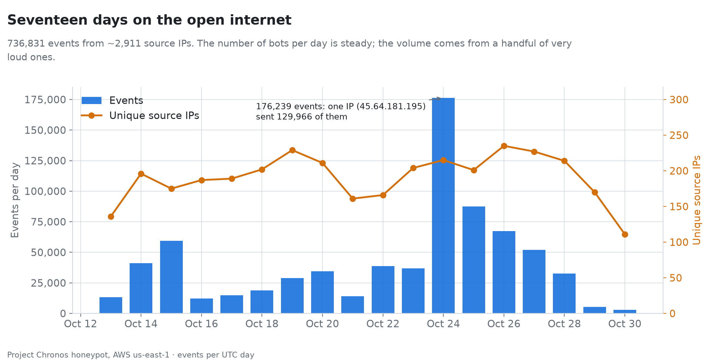
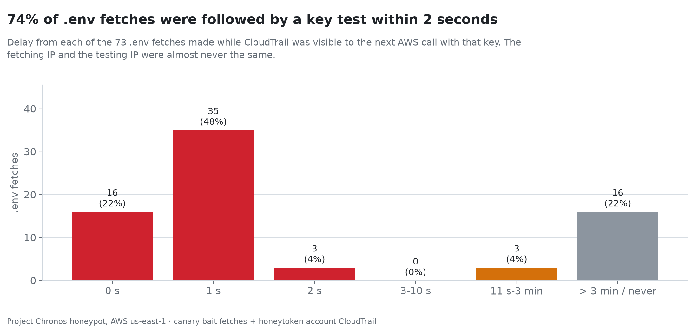
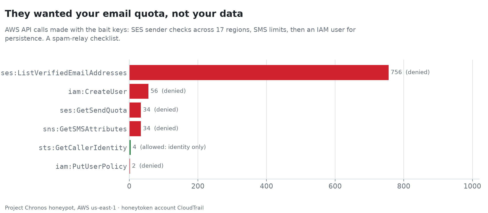
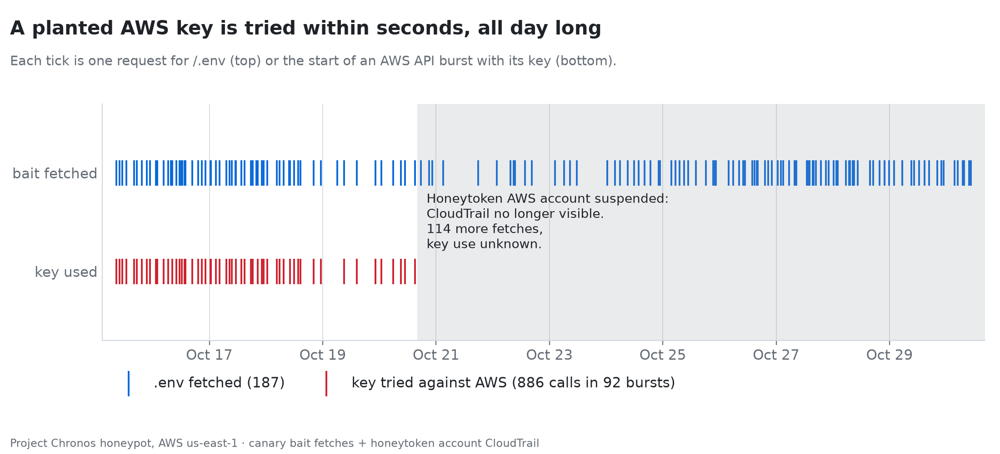
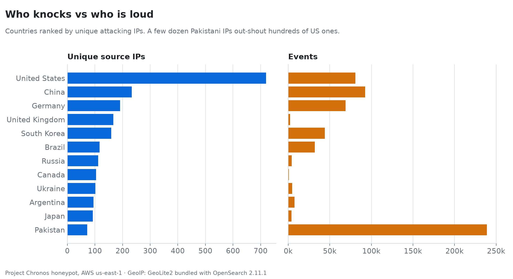
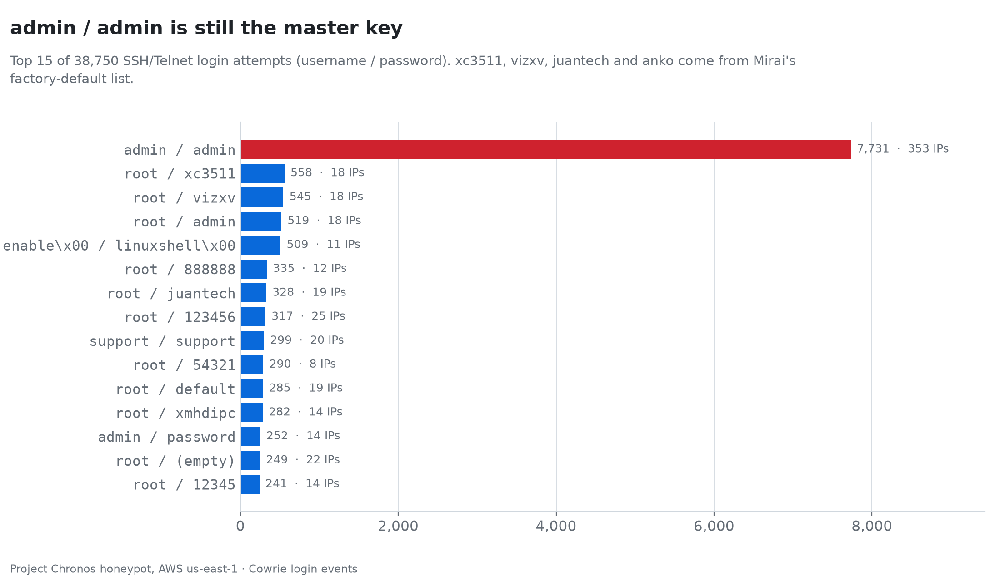
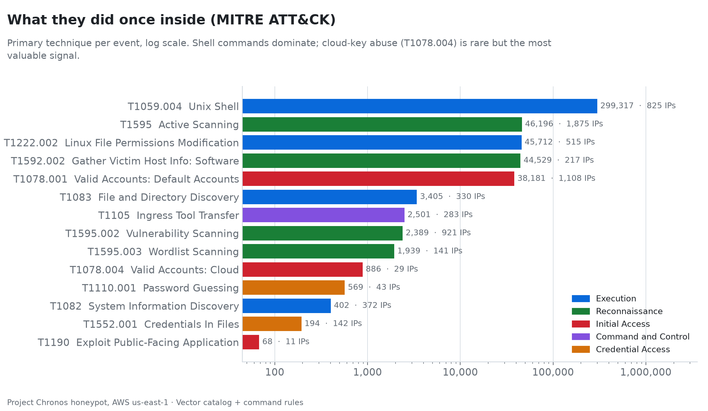

# Project Chronos

A lightweight, workplace-style SOC on two AWS EC2 instances. An internet-facing honeypot sensor captures automated SSH, Telnet and HTTP bot traffic; a separate SOC core turns it into searchable telemetry, triaged alerts and a findings report.

**Findings (Oct 13–30 2026):** [full report](reports/findings-2026-10-30.md) · charts in [`reports/charts/`](reports/charts/)

---

## Findings

Seventeen days on the open internet: ~736,000 events from ~2,900 source IPs, every one of them unsolicited.



**A planted AWS key is tried in about a second.** The HTTP canary serves a Laravel-style `/.env` with a real (deny-all) AWS key. It was fetched 187 times by 141 IPs. While CloudTrail was visible, 74% of fetches were followed by an AWS call with that key within 2 seconds, almost always from a *different* IP: a harvester fetching through dozens of rotating addresses (62 in one UK ISP range alone) and handing the key to a small set of validator hosts.



**They want your email quota.** Every one of the 886 key-use calls was a spam-relay capability check: SES sender lists in 17 regions, SES send quota, SNS SMS limits, then `iam:CreateUser` / `iam:PutUserPolicy` for persistence. All were denied except `sts:GetCallerIdentity`. The `wp-config.php.bak` key (6 fetches) and the `.git` key (1 IP dumped deep enough to reach it) were never used, and not one SSH bot looked at the `~/.aws/credentials` planted in Cowrie: the shell bots run their script and leave.



**AWS suspended the honeytoken account.** After five days of key abuse, AWS suspended the member account holding the bait keys (last successful CloudTrail poll 2026-10-20 15:58 UTC). The bait kept being fetched (114 more `.env` fetches) but key use after that is invisible.



**Volume is a few loud bots, not a crowd.** One IP (NetSol Connect, Pakistan) produced 175,560 events (24% of the dataset) in 11 hours: 21,908 sessions that each logged in and ran `echo -e "\x6F\x6B"`. The 37,715 sessions that ran commands collapse into 143 bot families; 89% only fingerprint the box.



**Mirai's password list is alive.** `admin/admin` alone was tried 7,731 times from 353 IPs; `xc3511`, `vizxv`, `juantech` and `anko` (Mirai's 2016 factory-default list) are all in the top 20.





**Scanners don't read the fingerprint.** The canary pins each IP to one of four server personas (IIS, Apache+PHP, nginx, Boa router). Product-specific paths drew 0–2.5% of each persona's IPs with no persona pulling ahead: bots fire the same wordlist whatever the `Server` header says.

---

## Architecture

```
[Public Internet / bots]
         │  :22 SSH, :23 Telnet, :80 HTTP
         ▼
┌──────────────────────────────────────────┐
│  chronos-sensor  (t4g.micro, AL2023)     │  assumed-compromised, disposable
│  ├─ Cowrie SSH/Telnet  (:22, :23)        │  host sshd moved to :22222 (SSM-only admin); breadcrumbs
│  ├─ Canary HTTP        (:80)             │  per-IP server personas; honeytoken bait
│  └─ Vector edge        tail → disk buffer│  ships raw JSON lines, no parsing
└──────────────┬───────────────────────────┘
               │ :9002 private IP, chronos-soc-sg admits chronos-sensor-sg only
               ▼
┌──────────────────────────────────────────┐
│  chronos-soc-core  (m7i-flex.large)      │  zero inbound from the internet
│  ├─ Vector core     normalize + classify │  catalog CSV + command rules → severity, MITRE
│  ├─ OpenSearch 2.11 template, GeoIP, ISM │  chronos-logs-* (live) / chronos-replay-* (synthetic)
│  ├─ Splunk Free (:8000)                  │  second SIEM over the live index via Vector HEC
│  ├─ OpenSearch Dashboards (:5601)        │
│  ├─ TheHive 5.2 (:9000)                  │  one alert per attacker session
│  ├─ triage loop                          │  OpenSearch → TheHive, idempotent by session
│  └─ honeytoken poller (optional)         │  honeytoken account CloudTrail → Vector → TheHive
└──────────────────────────────────────────┘
               │ SSM port forwarding (outbound TLS only)
               ▼
        Analyst Mac: localhost:9000 TheHive, :5601 Dashboards, :8000 Splunk
```

Design rules:

1. **The sensor only collects and holds.** Vector on the sensor tails Cowrie and canary logs and forwards raw lines. It keeps read positions and unsent events in a 1 GiB disk buffer that blocks rather than drops, so the core can be stopped to save money while the sensor keeps collecting (a 10-day core outage replayed without loss).
2. **One place for single-event detection.** `config/vector/threat_enrichment.csv` maps each event type to a severity (1–5) and MITRE ATT&CK technique. Command rules in `config/vector/vector-core.yaml` refine shell commands (T1105 download, T1098.004 SSH key, T1496 miner, T1082 discovery, ...). Unit tests live in `config/vector/tests/`.
3. **Events → alerts → cases.** On a honeypot every event is hostile, so per-event alerts are noise. `scripts/triage-automation.py` raises **one TheHive alert per Cowrie session** that reaches severity ≥ 4 (successful login onwards), keyed by the Cowrie session id, and **one per honeytoken key use** (bait + source address + UTC day), with the CloudTrail calls, user agents, whether that IP fetched the bait, and a loud flag if any call other than `GetCallerIdentity` succeeded. `sourceRef` makes re-runs idempotent. Analysts promote alerts to cases in TheHive.
4. **Synthetic data never mixes with live data.** The replay harness writes to `replay/` on the core and is indexed into `chronos-replay-*`. Live sensor events go to `chronos-logs-*`.
5. **Attacker strings are untrusted.** Commands and credentials are placed in fenced code blocks or escaped code spans in TheHive alerts and in the findings report.
6. **The sensor can't be used as compute.** Cowrie emulates commands (nothing an attacker types executes) and fakes SSH port-forwarding. Decoy containers run non-root with no capabilities, `no-new-privileges` and read-only root filesystems. Cowrie's real fetches (`wget`/`curl`/`nc`, used for payload capture) are capped at 10 MB. `chronos-sensor-sg` admits only TCP 22/23/80 and allows egress only to TCP 80/443 (payload capture, SSM, image pulls) and 9002 to the core's security group. `chronos-soc-sg` admits only 9002 from the sensor's group and allows egress only to TCP 80/443 (AWS APIs, SSM, GitHub, image and package pulls). IMDSv2 with hop limit 1 keeps containers away from instance credentials. The Cowrie image is pinned by digest and the canary's Flask/Werkzeug by version, so upstream releases only arrive through a reviewed change.

### Data model (OpenSearch)

| Field | Type | Notes |
| :--- | :--- | :--- |
| `timestamp` | date | event time from the honeypot; picks the daily index |
| `src_ip` | ip | GeoIP → `geo.country_name`, `geo.location`; ASN → `as.asn`, `as.organization_name` |
| `session`, `eventid`, `honeypot` | keyword | Cowrie session id / event type; `cowrie`, `canary` or `honeytoken` |
| `severity` | integer | 1–5 |
| `mitre_technique`, `mitre_tactic`, `command_techniques` | keyword | primary technique, and every technique a command matched |
| `username`, `password`, `input` | keyword | credentials and shell commands |
| `path`, `query`, `body`, `user_agent`, `headers` | keyword / flat_object | canary HTTP requests |
| `persona`, `status` | keyword / integer | canary persona that answered (`iis`, `apache-php`, `nginx`, `router-boa`) and the HTTP status it returned |
| `bait`, `honeytoken_served` | keyword / boolean | canary bait file served (`dotenv`, `wp-config`, `git`) and whether the response contained its AWS key |
| `aws_event_source`, `aws_event_name`, `aws_region`, `aws_error_code` | keyword | honeytoken key use from CloudTrail |

GeoIP uses the GeoLite2 City/ASN databases bundled with OpenSearch 2.11.1, built in Nov 2023. Indices are deleted after 60 days by the `chronos-retention` ISM policy.

---

## Experiments

### HTTP server personas

`honeypots/canary_http/app.py` pins each source IP (by sha256) to one of four personas: IIS 10, Apache 2.4 with PHP (answers the PHPUnit `eval-stdin.php` RCE probe as if vulnerable), nginx 1.18, or a Boa GPON router login (`/boaform/admin/formLogin`, `formPing`). Personas differ only in fingerprint (`Server` header, default page, 404 page) and product pages; unknown paths return the persona's 404. Because assignment is random per IP, scanners that ignore the fingerprint hit every product path family at the same rate across personas; a persona pulling ahead on its own family means the scanners adapt. Adding or removing a persona reassigns every IP, so start a new analysis window when `PERSONAS` changes.

### Honeytokens and breadcrumbs

Every bait carries its own AWS key pair, so a key-use alert names the file that leaked:

| Bait | Where | Variables |
| :--- | :--- | :--- |
| `GET /.env` | canary, Laravel-style `.env` | `HONEYTOKEN_DOTENV_AWS_KEY_ID`, `HONEYTOKEN_DOTENV_AWS_SECRET` |
| `GET /wp-config.php.bak` | canary, WordPress config with WP Offload Media keys | `HONEYTOKEN_WPCONFIG_AWS_*` |
| `GET /.git/…` | canary, dumpable repository (loose objects + index); the key is only in the committed `.env.production` blob, so it shows how deep each dumper goes | `HONEYTOKEN_GIT_AWS_*` |
| `/root/.aws/credentials` | Cowrie fake filesystem, next to a `/root/.bash_history` that points at `deploy@192.168.50.12` and `aws s3` commands | `HONEYTOKEN_COWRIE_AWS_*` |

`honeypots/cowrie/start-cowrie.py` wraps Cowrie's entrypoint: it copies the image's own `fs.pickle`, plants the breadcrumbs, and execs `twistd`. Bait with no key pair configured stays off (404 on the canary, no `/root/.aws` in Cowrie); `/root/.bash_history` is always planted. The fake internal hosts (`192.168.50.0/24`) are outside the VPC and Docker ranges, so nothing real answers. Vector tags the follow-up: `canary.honeytoken` (T1552.001) when a response carried a key, and the Cowrie command rules T1552.001 (AWS credentials), T1552.003 (reading shell history) and T1021.004 (`ssh`/`scp` to `user@host`).

The keys are self-hosted, so key-checking tools can't recognise them the way TruffleHog recognises canarytokens.org keys by their AWS account ID. `scripts/honeytokens-provision.sh <new-account-email>` (run once from the Mac with an admin `default` profile plus `chronos`; safe to re-run) sets up:

| Where | What |
| :--- | :--- |
| AWS Organization (Chronos account = management account) | member account `chronos-honeytokens`, holding nothing but the honeytokens |
| SCP on that account | denies every action to every IAM user in it, on top of each user's own deny-all policy |
| Honeytoken account | one IAM user + access key per bait (`billing-api-prod`, `wp-offload-media`, `billing-deploy`, `s3-backup-sync`: the names a `GetCallerIdentity` reveals). Keys authenticate but every call is denied. |
| Honeytoken account | role `ChronosHoneytokenReader`: `cloudtrail:LookupEvents` + `ec2:DescribeRegions`, assumable only by `ChronosCoreRole` |
| Chronos account | role `ChronosCoreRole` on chronos-soc-core only: the core's SSM/CloudWatch policies + assume the reader role. The sensor keeps `ChronosEdgeSSMRole` and can't reach the reader role. |

The script writes `honeytokens.env` at the repo root (gitignored, mode 600) and finishes by proving every key authenticates and is denied `s3:ListAllMyBuckets`. Those check calls come from your IP, so exclude it from the findings report. Never commit `honeytokens.env`: the repo is public, the account id inside the keys would tie them to it, and GitHub scrapers would trigger them, so alerts could no longer be traced to a bait. `scripts/deploy.sh sensor` copies only the bait key pairs to the sensor; `scripts/deploy.sh core` copies only the key ids and the reader role to the core and enables the `honeytokens` compose profile when `HONEYTOKEN_READER_ROLE_ARN` is set.

`scripts/honeytoken-poller.py` (core, every 5 minutes) assumes the reader role, looks up each key's CloudTrail event history in every enabled region and appends new events to `honeytoken/events.json` for Vector (`honeytoken.key_used`, severity 5, T1078.004). The triage loop turns them into critical TheHive alerts (type `honeytoken-key-use`). Event history is free and keeps 90 days, and the poller resumes from its last successful poll, so stopping the core only delays alerts. CloudTrail delivers events about 5–15 minutes after the call. Harvesters fetch and use keys from different IPs, so a use with no matching fetch is itself a finding.

> **Expect the honeytoken account to be suspended.** Publicly served keys get abused within seconds, and AWS suspended `chronos-honeytokens` after five days (see [Findings](#findings)). Once that happens `AssumeRole` on the reader role returns `AccessDenied`; comment out `HONEYTOKEN_READER_ROLE_ARN` in `honeytokens.env` and redeploy the core to retire the poller. Bait fetches keep being logged on the sensor.

---

## Deploy

Both instances pull this repository from GitHub over SSM, so push your branch first.

```bash
scripts/deploy.sh core   [git-ref]   # OpenSearch, Dashboards, TheHive, Vector, triage, Splunk + bootstrap
scripts/deploy.sh sensor [git-ref]   # sshd→22222, swap, Cowrie, canary, Vector edge
```

`deploy.sh core` creates `THEHIVE_SECRET_KEY` in the core's `.env` and runs `scripts/core-bootstrap.py`, which:

- installs the ingest pipeline, index template and ISM policy
- imports the Dashboards saved objects from `config/opensearch/dashboards.ndjson`
- rotates TheHive's default admin password
- creates the `chronos` organisation, the `analyst@chronos.local` user and the triage service account

Generated credentials (`THEHIVE_ADMIN_PASSWORD`, `THEHIVE_ANALYST_PASSWORD`, `THEHIVE_API_KEY`) stay in the core's `.env` and are never committed. To read them: `aws ssm start-session --target <core>`, then `sudo cat /home/ssm-user/Chronos/.env`.

## Verify

```bash
# On the core (repo root):
scripts/verify-gate1.sh   # template/pipeline/ISM present; replay event tagged and kept out of chronos-logs-*
scripts/verify-gate2.sh   # replayed session → exactly one TheHive alert; a second triage run adds none
docker run --rm -v "$PWD/config/vector:/etc/vector:ro" timberio/vector:0.34.1-alpine \
  test /etc/vector/vector-core.yaml /etc/vector/tests/vector-core.test.yaml

# From the Mac:
nc -zv <sensor-public-ip> 22 && nc -zv <sensor-public-ip> 23 && nc -zv <sensor-public-ip> 80   # must succeed
nc -zv -G 5 <core-public-ip> 9002                                                               # must fail
```

## Findings report and charts

Run from the Mac with `./start_chronos.sh` tunnelling :9200 (or on the core). Exclude every IP you tested from, including the one `honeytokens-provision.sh` ran from:

```bash
python3 scripts/findings-report.py --exclude-ip <your-ip> [--exclude-ip <older-ip> ...]
uv run scripts/findings-charts.py  --exclude-ip <your-ip> [--honeytoken-visible-until 2026-10-20T15:58:14]
```

`findings-report.py` (stdlib only) writes `reports/findings-<date>.md`:

- collection window and daily volume
- top countries and ASNs
- MITRE techniques
- top credentials
- top commands
- bot families (sessions grouped by normalized command sequence) with enumeration patterns
- canary paths and user agents
- experiment: HTTP server personas (requests per persona, product path families per persona, top paths)
- experiment: honeytoken bait and breadcrumbs (bait fetches, key recipients, `.git` dump depth per IP, Cowrie breadcrumb commands, CloudTrail key use)

It exits non-zero if any non-experiment section has no data. Experiment sections show `_No data yet._` until the bait is live.

`findings-charts.py` reuses the report's OpenSearch client and filters and writes the PNGs in `reports/charts/` (daily volume, countries, MITRE techniques, credentials, honeytoken timeline, fetch-to-use latency, AWS API calls). `uv` pulls matplotlib into a throwaway environment. `--honeytoken-visible-until` marks when CloudTrail visibility ended (default: the last key-use event).

---

## Splunk (second SIEM)

Splunk Free runs on the core as a second SIEM over the same live events, so detections can be written and compared in both OpenSearch query DSL and SPL. Vector's `splunk_hec_logs` sink mirrors the live index (`.ingest_stream == "logs"`, so synthetic replay never reaches it) into Splunk over HEC, with its own drop-when-full disk buffer so a Splunk outage never backs up the OpenSearch path. The app lives in `config/splunk/chronos/`; `scripts/deploy.sh core` packages it as a tgz and Splunk installs it with `SPLUNK_APPS_URL` (a bind mount into `/opt/splunk` breaks Splunk's startup).

Enabled by the `splunk` compose profile, which `deploy.sh core` turns on while generating `SPLUNK_PASSWORD` and `SPLUNK_HEC_TOKEN` in the core `.env`. The UI is on `127.0.0.1:8000` (SSM tunnel only; `./start_chronos.sh` opens it). Splunk Free has no login roles and no scheduled alerting, so the five detections are saved reports, run from the Chronos app, the `Chronos - Detections` dashboard, or the CLI; alerting stays in TheHive.

Detections (each mirrors a `config/vector/vector-core.yaml` rule, so the two engines can be compared):

| Detection | Technique | Logic |
| :--- | :--- | :--- |
| SSH brute force | T1110.001 | >= 10 failed Cowrie logins per source IP per 10-minute window |
| Successful login after brute force | T1078.001 | a login success from an IP with >= 5 prior failures |
| Download then execute in one session | T1105 -> T1222.002 | a session that both stages a tool and `chmod`s it |
| SSH key persistence by campaign | T1098.004 | `authorized_keys` writes grouped by key comment (campaign marker) |
| Honeytoken key used | T1078.004 | honeytoken AWS key use; flags any success other than `GetCallerIdentity` |

Vector only mirrors new events, so `scripts/splunk-backfill.py` loads history once (OpenSearch `chronos-logs-*` -> HEC, oldest first, with a daily size guard well under Free's 500 MB/day). Pass `--until <earliest Splunk time>` so it never overlaps the live stream.

---

## Administration

Day-to-day commands live in [`COMMANDS.md`](COMMANDS.md). The essentials:

```bash
export AWS_PROFILE=chronos        # least-privilege IAM user chronos-operator (config/iam/chronos-operator-policy.json)
./start_chronos.sh                # start both instances if stopped, compose up both, SSM tunnels 9000 / 5601 / 9200 / 8000
./stop_chronos.sh                 # stop the core only; the sensor keeps collecting and buffers events
./stop_chronos.sh --all           # stop both instances
```

`start_chronos.sh`, `stop_chronos.sh` and `scripts/deploy.sh` share `scripts/lib/ssm.sh` (SSM `send-command` runner, wait-for-SSM, start-if-stopped). The `chronos-operator` IAM user can only: describe EC2/SSM, start/stop/reboot the two Chronos instances, edit the two Chronos security groups, and open SSM sessions or send commands to those two instances.

---

## Responders

`responders/tarpit_responder.py` is a planned tarpit responder and is not yet implemented. It only queries OpenSearch and prints matching events.

---

## Documentation

Design documents (scope, architecture, and the implementation plan) are kept private and are not published in this repository.
